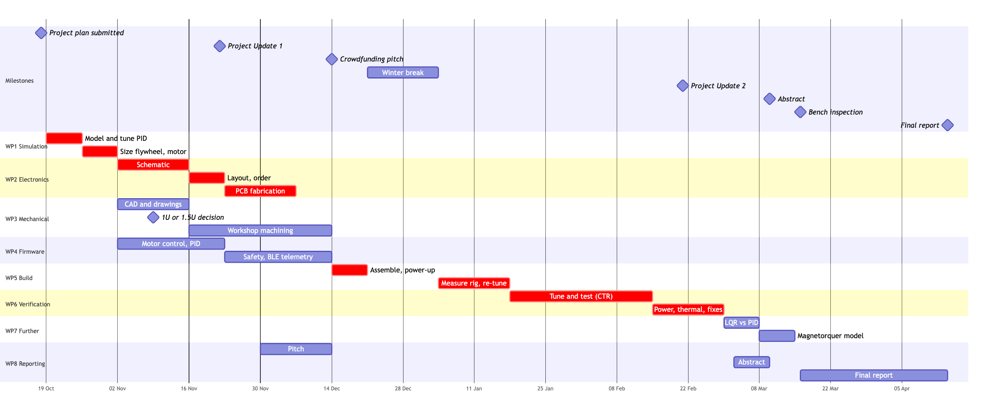
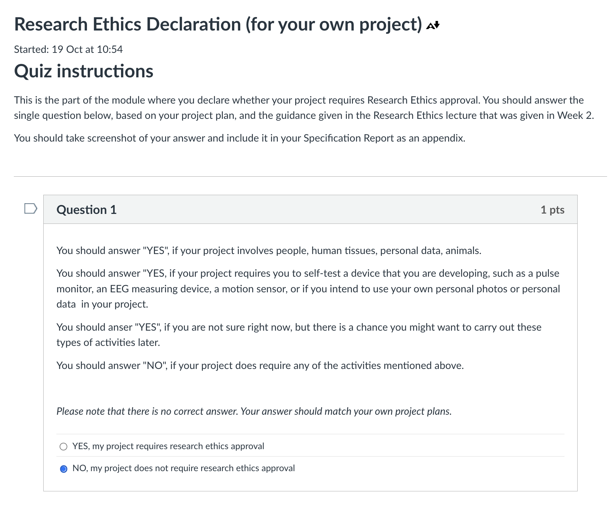

#+TITLE: Torque-Uno
#+AUTHOR: Tama Harrison
#+bibliography: references.bib
#+STUDENT_ID: 201858118
#+SUPERVISOR: Kai Hoettges
#+ASSESSOR: ........

# Build the Word document with `make` in this folder (M-x compile RET make).
# Output: Project-Plan.docx
#
# - The cover page is generated from the keywords above.
# - A line of five dashes (-----) is a page break.
# - Lines starting with "# " (like these) are comments and are not exported.

_Declaration of academic integrity_

By submitting this work, I confirm that I have read and understood the University's Academic Integrity Policy.

By submitting this work, I confirm that I have acted honestly, ethically and professionally in conduct leading to assessment for the programme of study.

By submitting this work, I confirm that the work I am submitting is my own. I have not commissioned production of the work from a third party or used artificial intelligence software in an unacceptable manner to generate the work*. I have not copied material from another person or source, nor committed plagiarism, nor fabricated, falsified or embellished data when completing the attached piece of work. I have not colluded with any other student in the preparation and/ or production of this work.

/*Software applications include but are not limited to, ChatGPT, Bing Chat, DALL.E, Bard/

-----

* Contents

#+TOC: headlines 2

* Project Scope

# ~500 words, 4 paragraphs:
# 1. Aim (~100): what a reaction wheel does; the brief (model in MATLAB, build, compact, prototype)
# 2. Achieve (~100): 1U body on turntable, slew and hold, low power; sim results so far
# 3. State of the art (~200): commercial wheels vs Torque-Uno (table + [1], [2], [4]); 1U limits [3];
#    why 600 rpm cap and ball-bearing rig instead of air bearing
# 4. Who benefits (~100): student CubeSat teams; validated sim; what a ground rig can't show

This project is a model satellite reaction wheel. The aim is to design, simulate and build a prototype satellite that uses the torque from a flywheel to rotate a body to a commanded angle. A controller will be designed to maximise the accuracy and precision of the rotation, while minimising the energy required. Reaction wheels are widely used in industry to precisely orient satellites such as the Hubble Space Telescope [cite:@hur2008three] and the James Webb Space Telescope [cite:@meza2005line]. They are compelling options for attitude control systems (ACS) because they do not consume fuel, [cite:see @weston2025soa, sections 5.2--5.4]. This project is a prototype ACS to be used as a demonstration of control theory, will be tested exclusively on Earth and will be affected by gravity --- this must be taken into account when running simulations. It will therefore not need to be vacuum-resistant, nor rated to operate in the cold conditions of space.

* Project Objectives

# ~250 words: one-line aim, then numbered SMART objectives (target, req IDs, WP, date from Gantt).
# Move the "why" (heat, friction in space) to scope.
# 1. Simulation: CTR-01 to CTR-04 met in sim with margin (WP1)
# 2. Hardware: body, PCB and turntable built and safe (PHY, ELE, SFT; WP2, WP3, WP5)
# 3. Firmware: control loop and telemetry (CTR-05, CTR-06, ELE-04; WP4)
# 4. Rig performance: CTR-01 to CTR-08 verified on rig (WP6)
# 5. Power and thermal: PWR-01 to PWR-03, THM-01 (WP6)
# 6. Further (stretch): STR-01, STR-02 (WP7)

The objective of this project is to design, simulate, and build a single-axis satellite reaction wheel can control the attitude of a model satellite, then hold this attitude to within \pm1\deg for 60 s. It should do this while generating as little heat as possible (measure \leq60\deg C), because in space it is very difficult to remove heat from the system --- there is no air to facilitate convection. It will be demonstrated by a 1U CubeSat satellite body footprint (10 \times 10 cm) on a low-friction bearing turntable to mimic the lack of any resistance in space. The demonstration will show a functional prototype which meets the [[Project Requirements]] laid out below at the bench inspection in March 2027.

The prototype will be simulated in MATLAB/Simulink. It will consist of a BLDC motor model and a PID controller that uses a Field-Oriented Control (FOC) algorithm commanding the motor to maximise electrical efficiency. The control algorithm should be able to complete a 90\deg slew to within 1\deg in <5 s, with an overshoot of <10%. This will be verified in a simulation report, to be completed in 2 weeks (by 1st November).

The PCB will then be designed to fit within a 1U CubeSat footprint. It will house the chosen microcontroller, ESP32; the fused battery; the V/I sensing components monitoring the battery; the motor driver; the MEMS gyro; and the latching power switch. This should be complete in 3 weeks (due by the week of the 16th November).

The frame will be designed to safely enclose the flywheel and electronics, and the bearing turntable will be designed to interface with the satellite body and allow free rotation. The design will be created in CAD software and drawings should be produced for the university workshop to manufacture the frame. The satellite body should conform to a 1U CubeSat footprint, with the height to be decided after motor selection. It should have fixings for the motor on the bottom, and the PCB on the top face. The design should be as symmetrical as possible so as to keep the centre of mass \le2 mm from the axis of rotation. The bearing turntable should contain a rotating shaft, vertical to within 0.1\deg. Bearings should be chosen such that the friction torque is \le3 mN\cdot{}m. The design is to be complete by the winter break. The system will then be assembled, tested, and compared to the simulation data. The measured values of torque, friction, mass etc. will be fed back into the model to fine tune the control algorithm.

-----
* Project Requirements
** Attitude control
| ID     | Requirement                                               | Value                                                                  | Verification                                       | Status |
|--------+-----------------------------------------------------------+------------------------------------------------------------------------+----------------------------------------------------+--------|
| CTR-01 | Hold commanded attitude about the vertical axis           | ±1° for 60 s; report true drift rate over 10 min                       | Overhead camera + printed protractor ring          | Agreed |
| CTR-02 | Rotate through a commanded 90° step                       | < 5 s to within ±1°                                                    | Overhead camera; gyro log                          | Agreed |
| CTR-03 | Overshoot on 90° slew                                     | < 10 %                                                                 | Overhead camera; gyro log                          | Agreed |
| CTR-04 | Recover from a hand-imparted disturbance                  | 20–40 °/s (gyro-measured); within ±1° in < 3 s                         | Gyro log for imparted rate; camera for recovery    | Agreed |
| CTR-05 | Baseline controller                                       | PID                                                                    | Demonstration                                      | Agreed |
| CTR-06 | Attitude sensing                                          | Onboard MEMS gyro only; full scale ≥ ±250 °/s; bias calibrated at rest | Design inspection; calibration log                 | Agreed |
| CTR-07 | Consecutive same-direction 90° slews, each meeting CTR-02 | ≥ 4                                                                    | Overhead camera; gyro and wheel-speed log          | Agreed |
| CTR-08 | Wheel saturation handling                                 | At speed cap: torque limited, flag in telemetry, no runaway            | Test (sustained disturbance to cap); telemetry log | Agreed |

** Physical
| ID     | Requirement                                                          | Value                                                                                                                     | Verification                 |
|--------+----------------------------------------------------------------------+---------------------------------------------------------------------------------------------------------------------------+------------------------------|
| PHY-01 | Rotating body fits a CubeSat envelope (100 × 100 mm footprint fixed) | 1U: 100 × 100 × 113.5 mm (CDS Rev 14.1); fallback 1.5U: 100 × 100 × 170.2 mm if the WP3 volume budget shows 1U cannot fit | Measurement                  |
| PHY-02 | Rotating body mass                                                   | ≤ 1.33 kg target (CDS limits: 2.00 kg for 1U, 3.00 kg for 1.5U); WP3 mass budget                                          | Weighing                     |
| PHY-03 | Body supported on a single vertical axis                             | 2 bearings, ground shaft; aluminium housing                                                                               | Design inspection            |
| PHY-04 | Overall centre of mass offset from rotation axis                     | ≤ 2 mm                                                                                                                    | CAD mass properties          |
| PHY-05 | Bearing friction torque about the vertical axis                      | ≤ 3 mN·m                                                                                                                  | Spin-down test               |
| PHY-06 | Rotation axis vertical                                               | Within 0.1°                                                                                                               | Spirit level on hub top face |

** Power
| ID     | Requirement                                 | Value                                 | Verification                   |
|--------+---------------------------------------------+---------------------------------------+--------------------------------|
| PWR-01 | Average power while holding, no disturbance | ≤ 2 W                                 | Measured V × I logged on board |
| PWR-02 | Runtime on one charge                       | ≥ 30 min                              | Timed test                     |
| PWR-03 | Energy per 90° slew                         | Report measured value                 | Measured V × I integration     |
| PWR-04 | Onboard power source                        | Protected 18650 Li-ion batteries, BMS | Design inspection              |

** Thermal
| ID     | Requirement                                                        | Value   | Verification   |
|--------+--------------------------------------------------------------------+---------+----------------|
| THM-01 | Motor and driver IC temperature after 10 min of repeated 90° slews | ≤ 60 °C | IR thermometer |

** Electronics
| ID     | Requirement                              | Value                                                      | Verification                            |
|--------+------------------------------------------+------------------------------------------------------------+-----------------------------------------|
| ELE-01 | Microcontroller                          | ESP32-S3 module on custom PCB                              | Design inspection                       |
| ELE-02 | Motor driver                             | BLDC, own driver on PCB, magnetic encoder on motor         | Design inspection                       |
| ELE-03 | Main PCB                                 | All-in-one, 2-layer                                        | Design inspection                       |
| ELE-04 | Wireless command and telemetry to laptop | BLE; telemetry ≥ 50 Hz: angle, rate, wheel speed, bus V, I | Demonstration; logged sample times      |
| ELE-05 | Onboard power measurement                | Battery bus voltage and current sensed on PCB              | Design inspection; check vs bench meter |

** Safety
| ID     | Requirement                                | Value                                                              | Verification                   |
|--------+--------------------------------------------+--------------------------------------------------------------------+--------------------------------|
| SFT-01 | Stop command from laptop disables motor    | Single key/button                                                  | Test before first battery spin |
| SFT-02 | Motor disabled on loss of laptop heartbeat | ≤ 0.5 s timeout                                                    | Test before first battery spin |
| SFT-03 | Latching power-isolation switch            | Top face of body; isolates battery from all loads                  | Test                           |
| SFT-04 | Flywheel speed hard limit in firmware      | ≤ 600 rpm                                                          | Test                           |
| SFT-05 | Flywheel enclosed                          | Aluminium enclosure; no acrylic or polycarbonate                   | Inspection                     |
| SFT-06 | Flywheel material                          | Aluminium or brass                                                 | Inspection                     |
| SFT-07 | Battery pack protection                    | Fuse at pack terminals; firmware low-voltage cut-off               | Inspection; bench-PSU test     |
| SFT-08 | Motor arming and current limit             | Motor enabled only after arm command; firmware motor current limit | Test                           |
| SFT-09 | PCB input protection                       | Reverse-polarity protection; input fuse; regen over-voltage clamp  | Design inspection; bench test  |

** Further objectives
| ID     | Objective                                        |
|--------+--------------------------------------------------|
| STR-01 | LQR controller compared against PID              |
| STR-02 | Magnetorquer momentum dumping modelled in MATLAB |

-----

* Work Packages

#+begin_workpackage
- WP Title :: Flywheel and Controller Simulation
- WP number :: 1
- Start Event :: Project plan submitted (18 Oct)
- Duration :: 2 weeks
- Objectives :: Size the flywheel and motor, and design a PID controller in MATLAB/Simulink so that the simulated body meets CTR-01 to CTR-04 with margin before any hardware is bought.
- Task Description ::
  - Simulink model of body, flywheel, BLDC motor (FOC), bearing friction and MEMS gyro
  - Tune PID; check stability margins
  - Decide required flywheel size and rpm cap
- Inputs ::
  - Project requirements
  - Estimated body mass, bearing friction
- Interfaces/links with other tasks or WPs ::
  - WP2 (motor current, torque limit), WP3 (flywheel dimensions, mass budget), WP4 (generated code runs on the hardware), and WP5 (re-run simulation with measured friction and mass)
- Deliverables ::
  - Simulink model and scripts
  - Flywheel specification and selected motor
#+end_workpackage

#+begin_workpackage
- WP Title :: Electronics Design
- WP number :: 2
- Start Event :: WP1 complete (motor selected)
- Duration :: 3 weeks design + 2 weeks PCB fabrication
- Objectives :: Design a single 2-layer PCB holding the ESP32-S3 module, BLDC driver, gyro interface, power measurement and protection circuitry, meeting the electronics and safety requirements.
- Task Description ::
  - Block diagram
  - Component selection: ESP32-S3 module, BLDC driver IC, magnetic encoder, MEMS gyro, current/voltage sense, BMS
  - Schematic in KiCad, including:
    - Latching power-isolation switch (SFT-03)
    - Fuse and low-voltage sensor (SFT-07)
    - Reverse-polarity protection, input fuse (SFT-09)
    - V and I sensing (ELE-05)
  - Order PCB and components
- Inputs ::
  - Motor, current and torque limit from WP1
  - Requirements ELE, PWR, SFT
- Interfaces/links with other tasks or WPs ::
  - Depends on WP1 (motor)
  - Board outline shared with WP3
  - Pin map shared with WP4
  - Board assembled and tested in WP5
- Deliverables ::
  - Schematic, PCB layout and manufacturing files
  - Bill of materials and submitted order
#+end_workpackage

#+begin_workpackage
- WP Title :: Mechanical Design
- WP number :: 3
- Start Event :: WP1 complete (flywheel and motor dimensions)
- Duration :: 2 weeks design + workshop lead time
- Objectives :: Design the CubeSat body (1U target, 1.5U fallback, PHY-01) with enclosed flywheel, and the bearing turntable it sits on, so that friction is low (PHY-05), the axis is vertical (PHY-06) and the centre of mass is on the axis (PHY-04).
- Task Description ::
  - Volume and mass budget in CAD; decide 1U or 1.5U by 9 November, before PCB layout (PHY-01, PHY-02)
  - Bearing turntable: base plate, shaft, mounting point for satellite
  - Flywheel and motor mount
  - Aluminium flywheel enclosure (SFT-05)
  - Body frame: PCB, battery pack, switch on top face (SFT-03)
  - CAD mass properties: centre of mass offset, body inertia, total mass
  - Workshop drawings and Fabrication Request Form
- Inputs ::
  - Flywheel dimensions and motor from WP1
  - PCB outline from WP2
  - Bearing turntable specification
- Interfaces/links with other tasks or WPs ::
  - Body size decision (1U or 1.5U) fixes the PCB outline for WP2 layout
  - Body inertia and mass fed back to WP1
  - Parts assembled in WP5
- Deliverables ::
  - CAD assembly
  - Workshop drawings and submitted fabrication request
  - Volume and mass budget, with the 1U or 1.5U decision
  - Mass and inertia report
#+end_workpackage

#+begin_workpackage
- WP Title :: Firmware
- WP number :: 4
- Start Event :: WP1 complete; development boards received
- Duration :: 6 weeks, on development boards until the PCB arrives
- Objectives :: Write ESP32-S3 firmware that runs FOC motor control, gyro attitude estimation and the PID loop at 1 kHz, streams telemetry over BLE, and enforces the safety requirements.
- Task Description ::
  - Motor FOC with encoder; speed and torque modes
  - Gyro driver and bias calibration at rest (CTR-06)
  - Attitude estimate and discrete PID from WP1 (CTR-05)
  - Safety: arm command and current limit (SFT-08), 600 rpm hard limit (SFT-04), stop command (SFT-01), heartbeat timeout (SFT-02), low-voltage cut-off (SFT-07), saturation flag (CTR-08)
  - BLE command and telemetry ≥ 50 Hz (ELE-04)
  - Laptop logging and control script
- Inputs ::
  - Controller gains and sample time from WP1
  - Pin map from WP2
- Interfaces/links with other tasks or WPs ::
  - Depends on WP1
  - Ported to the custom PCB in WP5
  - Used for all tests in WP6
- Deliverables ::
  - Firmware repository
  - Laptop telemetry logger
  - Safety-function test log on development boards
#+end_workpackage

#+begin_workpackage
- WP Title :: Build and Rig Measurement
- WP number :: 5
- Start Event :: PCB and machined parts received
- Duration :: 5 weeks
- Objectives :: Assemble and power up the hardware safely, then measure the real rig parameters and re-run the simulation with them.
- Task Description ::
  - PCB assembly
  - Staged power-up on bench PSU
  - Flash firmware; repeat safety tests before first battery spin
  - Assemble turntable
  - Bearing spin-down test for friction measurement (PHY-05)
  - Measure body mass and inertia (PHY-02)
  - Re-run WP1 simulation with measured values; re-tune PID
- Inputs ::
  - PCB and BOM (WP2), machined parts (WP3), firmware (WP4)
- Interfaces/links with other tasks or WPs ::
  - Depends on WP2, WP3, WP4
  - Measured parameters fed back to WP1
- Deliverables ::
  - Working assembled system
  - Friction and inertia measurements
  - Updated simulation and controller gains
#+end_workpackage

#+begin_workpackage
- WP Title :: Integration, Tuning and Verification
- WP number :: 6
- Start Event :: WP5 complete
- Duration :: 6 weeks
- Objectives :: Tune the closed loop on the rig and verify every requirement using the method in its table.
- Task Description ::
  - Closed-loop tuning on the rig
  - Attitude tests: hold, 90° slew, disturbance, consecutive slews, saturation (CTR-01 to CTR-08)
  - Power and runtime tests (PWR-01 to PWR-03)
  - Temperature after 10 min of slews (THM-01)
  - Compare measured results against simulation
  - Fix and re-test any failures
- Inputs ::
  - Assembled system and updated model from WP5
  - Overhead camera and protractor ring, IR thermometer
- Interfaces/links with other tasks or WPs ::
  - Depends on WP5
  - Results used in WP7 and WP8
- Deliverables ::
  - Requirements verification table (measured vs target)
  - Test logs and videos
#+end_workpackage

#+begin_workpackage
- WP Title :: Further Objectives (LQR and Magnetorquer)
- WP number :: 7
- Start Event :: Core requirements CTR-01 to CTR-04 met in WP6
- Duration :: 2 weeks
- Objectives :: Compare an LQR controller against PID (STR-01) and model magnetorquer momentum dumping in MATLAB (STR-02).
- Task Description ::
  - Design LQR on the identified model; run in simulation
  - Run LQR controller on the rig; compare against PID
  - Model a magnetorquer for momentum dumping in the same Simulink model
- Inputs ::
  - Identified model from WP5, test setup from WP6
- Interfaces/links with other tasks or WPs ::
  - Depends on WP5 and WP6
  - Uses the same controller interface as WP4
- Deliverables ::
  - LQR vs PID comparison
  - Magnetorquer simulation results
#+end_workpackage

#+begin_workpackage
- WP Title :: Reporting and Assessments
- WP number :: 8
- Start Event :: Project plan submitted
- Duration :: Whole project
- Objectives :: Meet all milestones and keep a record of decisions and results.
- Task Description ::
  - Project Update 1 with supervisor (22 Nov)
  - Crowdfunding pitch (14 Dec)
  - Project Update 2 with supervisor (21 Feb)
  - Project abstract (10 Mar)
  - Bench inspection (16/17 Mar)
  - Final report (14 Apr)
  - Weekly logbook and supervisor meetings
- Inputs ::
  - Outputs of WP1 to WP7
- Interfaces/links with other tasks or WPs ::
  - Runs alongside all WPs
- Deliverables ::
  - Submitted pitch, abstract and final report
  - Logbook
#+end_workpackage

* Skills and Resource Audit
** Skills audit

# Level: e.g. none / basic / confident. Training needs: course, tutorial, or person.

| *Skill*                            | *Level*     | *Training needs*         |
|----------------------------------+-----------+------------------------|
| MATLAB/Simulink control design   | Confident | None                   |
| BLDC motor control (FOC)         | None      | Course                 |
| PCB design and SMD soldering     | Basic     | SMD Soldering Tutorial |
| ESP32 firmware (C/C++), BLE      | Basic     | Tutorials              |
| CAD (Onshape), workshop drawings | Basic     | Tutorials              |
| Li-ion battery handling          | Basic     | Course                 |

** Resource audit

| *Resource*                            | *Availability*                              | *Alternatives*             |
|-------------------------------------+-------------------------------------------+--------------------------|
| PCB fabrication                     | External manufacturer                     | University fabrication   |
| Mechanical workshop (machining)     | University fabrication                    | Off-the-shelf components |
| Electronic components               | Ordered via University-Approved Suppliers | N/A                      |
| Lab bench: PSU, oscilloscope, meter | Fourth-floor lab                          | N/A                      |
| Test kit: IR thermometer, camera    | Equipment in lab (ask technicians)        | Ordered online           |

-----

* References

#+print_bibliography:

* Appendix 1. Gantt Chart

#+begin_src mermaid :file gantt.png :scale 3 :exports results
---
config:
  gantt:
    useWidth: 1800
    fontSize: 13
---
gantt
  dateFormat YYYY-MM-DD
  axisFormat %d %b
  tickInterval 2week
  weekday monday
  todayMarker off

  %% Task name :[crit,] [milestone,] [id,] start, duration
  %%   start = a date or "after <id> [<id2> ...]"; crit = critical path (red)

  section Milestones
  Project plan submitted   :milestone, 2026-10-18, 0d
  Project Update 1         :milestone, 2026-11-22, 0d
  Crowdfunding pitch       :milestone, 2026-12-14, 0d
  Winter break             :break, 2026-12-21, 2w
  Project Update 2         :milestone, 2027-02-21, 0d
  Abstract                 :milestone, 2027-03-10, 0d
  Bench inspection         :milestone, bench, 2027-03-16, 0d
  Final report             :milestone, 2027-04-14, 0d

  section WP1 Simulation
  Model and tune PID       :crit, wp1a, 2026-10-19, 1w
  Size flywheel, motor     :crit, wp1b, after wp1a, 1w

  section WP2 Electronics
  Schematic                :crit, wp2a, after wp1b, 2w
  Layout, order            :crit, wp2b, after wp2a, 1w
  PCB fabrication          :crit, wp2c, after wp2b, 2w

  section WP3 Mechanical
  CAD and drawings         :wp3a, after wp1b, 2w
  1U or 1.5U decision      :milestone, 2026-11-09, 0d
  Workshop machining       :wp3b, after wp3a, 4w

  section WP4 Firmware
  Motor control, PID       :wp4a, after wp1b, 3w
  Safety, BLE telemetry    :wp4b, after wp4a, 3w

  section WP5 Build
  Assemble, power-up       :crit, wp5a, after wp2c wp3b wp4b, 1w
  Measure rig, re-tune     :crit, wp5b, 2027-01-04, 2w

  section WP6 Verification
  Tune and test (CTR)      :crit, wp6a, after wp5b, 4w
  Power, thermal, fixes    :crit, wp6b, after wp6a, 2w

  section WP7 Further
  LQR vs PID               :wp7a, after wp6b, 1w
  Magnetorquer model       :wp7b, after wp7a, 1w

  section WP8 Reporting
  Pitch                    :2026-11-30, 2w
  Abstract                 :2027-03-03, 1w
  Final report             :after bench, 2027-04-14
#+end_src

#+RESULTS:

-----

* Appendix 2. Risk Assessment Form
[[file:./risk-assessment-2026-10-13.pdf]]

-----

* Appendix 3. Ethics Self-assessment

-----

* COMMENT build
#+begin_src sh
make && open ./project-plan.docx
#+end_src

#+RESULTS:
| pandoc | Project-Plan.org                      | -f   | org | -o | Project-Plan.docx | \ |
|        | -d                                    | ieee | \   |    |                   |   |
|        | --reference-doc=pandoc/reference.docx | \    |     |    |                   |   |
|        | --lua-filter=pandoc/pdfpages.lua      | \    |     |    |                   |   |
|        | --lua-filter=pandoc/workpackage.lua   | \    |     |    |                   |   |
|        | --lua-filter=pandoc/cover.lua         | \    |     |    |                   |   |
|        | --shift-heading-level-by=1            |      |     |    |                   |   |
