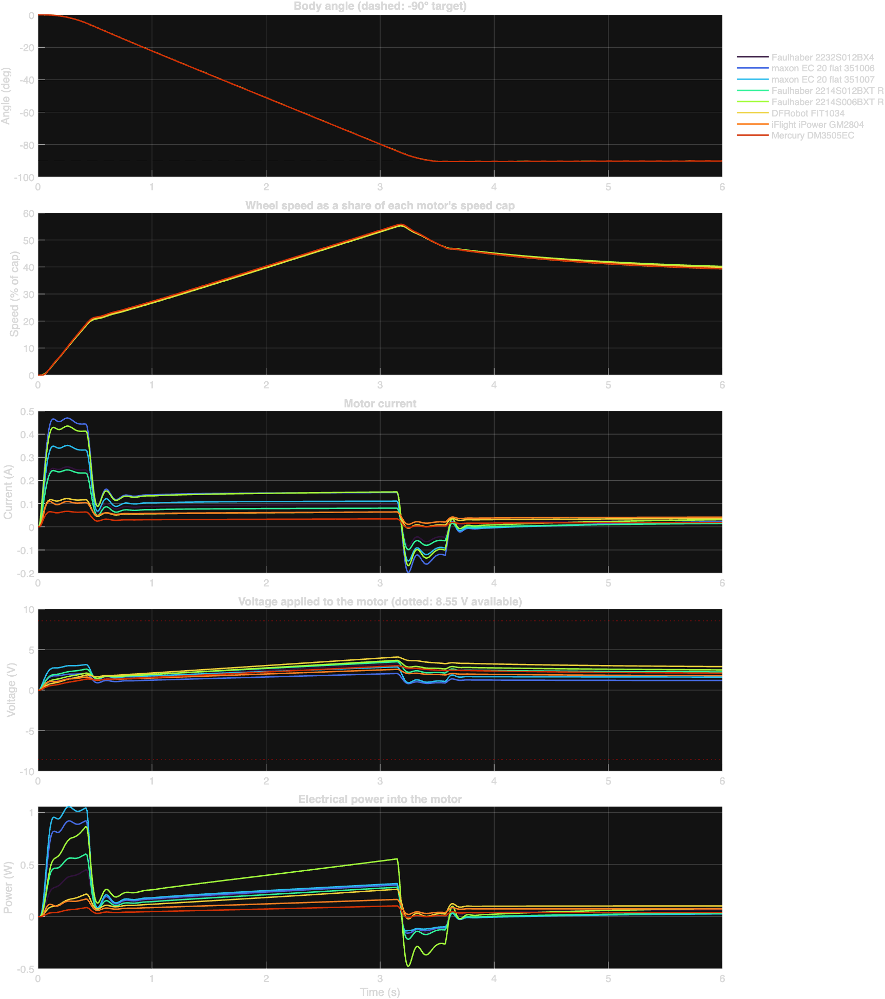
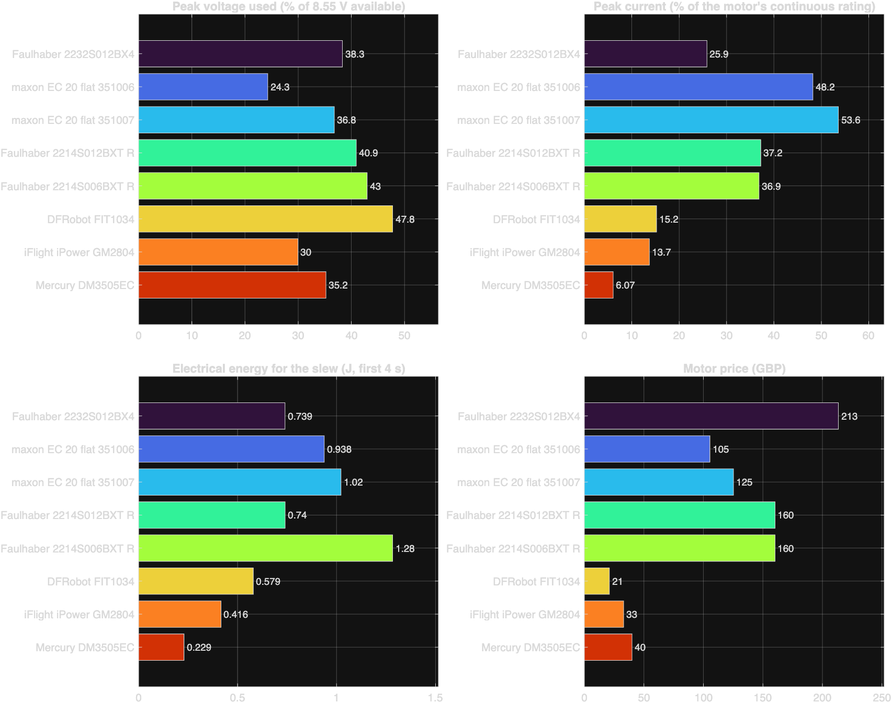
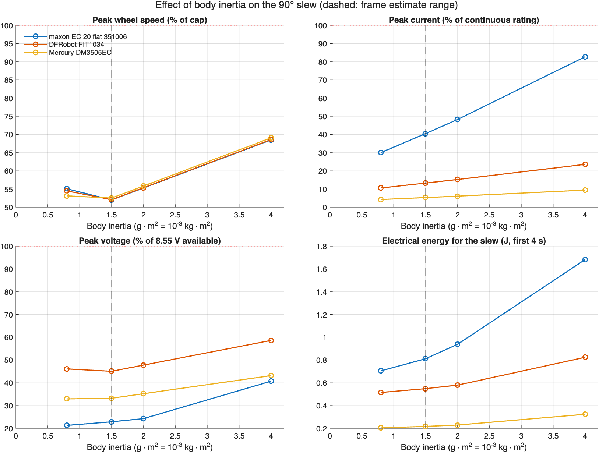

#+TITLE: Motor comparison by simulation --- 90° slew
#+STARTUP: showall inlineimages

# Working report drafted with Claude on 2026-11-11 (AI Tier 2: reword
# anything reused in an assessed report). Results come from the averaged
# Simulink model in MATLAB/07-motor-comparison/. They have not been checked
# against hardware. Regenerate everything with run_motor_comparison(9).

* Summary
- Every motor completes the 90° slew identically: within ±1° of the target at 3.37 s, with under 0.5% overshoot. The slew is set by the ramp limits (0.5 rad/s, 1.2 rad/s²), not by the motor.
- No motor comes near a limit from a 9 V supply. Peak voltage is 24–48% of what is available, peak current is 6–54% of each motor's continuous rating, and the wheel peaks at 55% of its speed cap.
- So this test doesn't separate the motors on performance. What separates them is price, energy use, and how much of their data is published.

| If the top speed is | Suggested motor         | Price | Why                                                                         |
|---------------------+-------------------------+-------+-----------------------------------------------------------------------------|
| 3000 rpm            | maxon EC 20 flat 351006 | £105  | Same slew as the Faulhaber for half the price; lowest voltage use (24%)     |
| 1500 rpm            | DFRobot FIT1034         | ~£21  | Same slew for a tenth of the price; encoder built in; values need measuring |
| 600 rpm             | Mercury DM3505EC        | ~£40  | Lowest energy and current; full datasheet; needs the 171 g wheel            |

*Suggestion on price:* the simulation gives no performance reason to pay £213 for the Faulhaber 2232S012BX4. At 3000 rpm the maxon 351006 does the same job for £105. If Kai accepts 1500 rpm, the FIT1034 does it for about £21, provided its real resistance, inductance and Kv are measured first.

What the Faulhaber still offers is efficiency and certainty: a third of the maxon's winding heat (0.17 J against 0.51 J per slew), the lowest current as a share of its rating at 3000 rpm (26%), a current product from a preferred supplier, and a rear shaft for the encoder.

* What was simulated
- *Model:* =MATLAB/07-motor-comparison/rw_averaged.slx=, with one saved copy per motor in =models/=. It keeps the position, speed and current loops, the wheel and body, and the friction of the switched model. The inverter's switching is replaced by its average voltage, and the motor by its datasheet equivalent circuit: V = R·i + L·di/dt + Kt·ω, torque = Kt·i.
- *Check against the switched model:* with the placeholder motor at 12 V, the averaged model gives the same slew as =06-current-control/bldc_current_control.slx=: settled at 3.369 s, 0.47% overshoot, 334 rpm peak, 248 rpm at the end. It runs in about 9 s instead of 390 s.
- *Scenario:* 0 to −90° through the slew profile, 6 s, from a 9 V supply (empty pack), duty limited to 95% (8.55 V available). Current limit 1.5 A.
- *Wheel per motor:* each motor runs at its own top-speed case, with the wheel inertia that gives 7.54 mN·m·s at that speed, and the speed cap set to that speed.
- *Controller gains:* derived from each motor's values so every motor has loops of the same speed (current 1 kHz; speed 54.5 rad/s; position 17 rad/s). See =motor_params.m=.
- *Speed-demand smoothing:* the position loop updates every 10 ms. Its speed demand passes through a 10 ms moving average (block =Speed Demand Smoothing=), so the speed loop sees a ramp instead of a staircase. Without it, each 10 ms step caused a burst of current, a 100 Hz saw-tooth (0.06 A peak-to-peak on the maxon 351006, cut to 0.003 A with smoothing). The slew itself is unchanged.
- *Body and turntable:* body inertia 0.002 kg·m²; turntable friction 1.0 mN·m sliding, 1.2 mN·m breakaway.

* Motor values used
From the datasheets, phase-to-phase. Values marked * are not published and are estimates.

| Motor                   | Speed case | Kt (mN·m/A) | R (Ω) | L (mH) | Rotor inertia (g·cm²) | No-load current | Continuous rating | Price   | Supplier              |
|-------------------------+------------+-------------+-------+--------+-----------------------+-----------------+-------------------+---------+-----------------------|
| Faulhaber 2232S012BX4   | 3000 rpm   | 17.0        | 3.5   | 0.115  | 5.1                   | 0.072 A         | 1.0 A             | £213.44 | RS 873-4818           |
| maxon EC 20 flat 351006 | 3000 rpm   | 8.82        | 3.54  | 0.424  | 5.1                   | 0.068 A         | 0.974 A           | £105.43 | maxon UK shop         |
| maxon EC 20 flat 351007 | 3000 rpm   | 11.8        | 7.45  | 0.754  | 5.1                   | 0.051 A         | 0.655 A           | £125.26 | RS 774-0525           |
| Faulhaber 2214S012BXT R | 3000 rpm   | 17.0        | 6.95  | 0.884  | 3.3                   | 0.039 A         | 0.66 A            | £160.20 | RS 184-6933           |
| Faulhaber 2214S006BXT R | 6000 rpm   | 9.58        | 2.42  | 0.271  | 3.3                   | 0.062 A         | 1.18 A            | £160.20 | RS 184-6932           |
| DFRobot FIT1034         | 1500 rpm   | 43.4        | 5.1   | 2.8    | 40*                   | 0.07 A*         | 0.8 A*            | ~£21    | Grobotronics (Greece) |
| iFlight iPower GM2804   | 600 rpm    | 56.8*       | 9.0   | 2.8*   | 40*                   | 0.09 A          | 0.8 A             | £33.00  | iFlight EU            |
| Mercury DM3505EC        | 600 rpm    | 80          | 6.34  | 1.08   | 56                    | 0.04 A*         | 1.1 A             | ~£40    | SparkFun ROB-27478    |

- *Motor friction:* the Faulhaber 2232 datasheet gives it directly (0.46 mN·m static plus 1.1e-4 mN·m per rpm). For the others it is the no-load current times Kt, split 40% constant and 60% proportional to speed.
- *GM2804 Kt:* from its listed no-load speed (about 168 rpm/V); its "load current 0.8 A" is used as the rating.

* Results
#+CAPTION: Body angle, wheel speed, current, voltage and power for each motor.

#+CAPTION: Peak voltage and current use, energy for the slew, and price.

| Motor                   | Price   | Settled within ±1° | Overshoot | Peak wheel speed | Peak current | Share of rating | Peak voltage | Share of 8.55 V | Winding heat | Energy in (4 s) | Peak power | Power to hold speed |
|-------------------------+---------+--------------------+-----------+------------------+--------------+-----------------+--------------+-----------------+--------------+-----------------+------------+---------------------|
| Faulhaber 2232S012BX4   | £213.44 | 3.37 s             | 0.44%     | 1658 rpm (55%)   | 0.26 A       | 26%             | 3.28 V       | 38%             | 0.17 J       | 0.74 J          | 0.45 W     | 0.062 W             |
| maxon EC 20 flat 351006 | £105.43 | 3.37 s             | 0.44%     | 1658 rpm (55%)   | 0.47 A       | 48%             | 2.08 V       | 24%             | 0.51 J       | 0.94 J          | 0.92 W     | 0.021 W             |
| maxon EC 20 flat 351007 | £125.26 | 3.37 s             | 0.44%     | 1658 rpm (55%)   | 0.35 A       | 54%             | 3.15 V       | 37%             | 0.60 J       | 1.02 J          | 1.06 W     | 0.022 W             |
| Faulhaber 2214S012BXT R | £160.20 | 3.37 s             | 0.44%     | 1658 rpm (55%)   | 0.25 A       | 37%             | 3.50 V       | 41%             | 0.28 J       | 0.74 J          | 0.60 W     | 0.028 W             |
| Faulhaber 2214S006BXT R | £160.20 | 3.37 s             | 0.44%     | 3312 rpm (55%)   | 0.43 A       | 37%             | 3.67 V       | 43%             | 0.31 J       | 1.28 J          | 0.86 W     | 0.069 W             |
| DFRobot FIT1034         | ~£21    | 3.37 s             | 0.45%     | 830 rpm (55%)    | 0.12 A       | 15%             | 4.08 V       | 48%             | 0.08 J       | 0.58 J          | 0.26 W     | 0.102 W             |
| iFlight iPower GM2804   | £33.00  | 3.37 s             | 0.48%     | 335 rpm (56%)    | 0.11 A       | 14%             | 2.56 V       | 30%             | 0.14 J       | 0.42 J          | 0.17 W     | 0.074 W             |
| Mercury DM3505EC        | ~£40    | 3.37 s             | 0.48%     | 335 rpm (56%)    | 0.07 A       | 6%              | 3.01 V       | 35%             | 0.03 J       | 0.23 J          | 0.10 W     | 0.039 W             |

All motors end within 0.09° of the target at 6 s. Results are with speed-demand smoothing (see What was simulated).

* What the results show
- *Same motion for every motor.* The profile asks for at most 2.4 mN·m plus about 1 mN·m of turntable friction, which every motor supplies with current to spare. The curves in the top two panels lie on top of each other.
- *Power budget.* Peak electrical power is 0.1–1.1 W for under half a second, and under 0.35 W averaged over the slew. All motors fit inside the 2 W budget (PWR-01) for this manoeuvre, before the electronics are counted.
- *Voltage headroom.* The FIT1034 uses the most (48%), because 1500 rpm is close to the top of its range. It still has half its voltage in hand for this slew.
- *Current headroom.* The two maxon windings work hardest relative to their ratings (48% and 54%), because their torque constants are low. The gimbal motors barely load their windings (6–15%).
- *Heat.* Winding heat per slew is small for all (0.03–0.60 J). The maxon motors make about three times the Faulhaber 2232's heat.
- *Faster wheels cost energy.* The 6000 rpm case takes the most energy (1.28 J), the 600 rpm cases the least, because the same momentum stored at higher speed means more kinetic energy.
- *Wheel speed left over.* The wheel ends at about 40% of its cap, not zero. Turntable friction takes momentum from the body during the slew, and the wheel has to carry it. Repeated slews in one direction would approach the cap for every motor alike.
- *Smooth current.* With the speed demand smoothed, each motor's current is a clean curve: a pulse while accelerating, a small steady current while cruising, and a negative pulse while braking. Firmware should smooth the demand the same way.

* Body inertia sweep (2026-11-12)
The runs above assume a body inertia of 0.002 kg·m². The 10×10 extrusion frame is estimated at 0.0008–0.0015 kg·m² for the whole body, so the slew was repeated for the three suggested motors at 0.0008, 0.0015, 0.002 and 0.004 kg·m², with the gains re-derived for each inertia. Run with =run_body_inertia_sweep()=.

#+CAPTION: Peak wheel speed, current, voltage and slew energy against body inertia. Dashed lines: frame estimate range.

| Motor                   | Body inertia (kg·m²) | Settled within ±1° | Overshoot | Peak wheel speed (% of cap) | Peak current (% of rating) | Peak voltage (% of 8.55 V) | Energy in (4 s) |
|-------------------------+----------------------+--------------------+-----------+-----------------------------+----------------------------+----------------------------+-----------------|
| maxon EC 20 flat 351006 |               0.0008 | 3.46 s             | 0%        | 55%                         | 30%                        | 21%                        | 0.71 J          |
| maxon EC 20 flat 351006 |               0.0015 | 3.39 s             | 0.18%     | 52%                         | 40%                        | 23%                        | 0.81 J          |
| maxon EC 20 flat 351006 |               0.002  | 3.37 s             | 0.44%     | 55%                         | 48%                        | 24%                        | 0.94 J          |
| maxon EC 20 flat 351006 |               0.004  | 3.35 s             | 0.84%     | 68%                         | 83%                        | 41%                        | 1.68 J          |
| DFRobot FIT1034         |               0.0008 | 3.45 s             | 0%        | 54%                         | 11%                        | 46%                        | 0.51 J          |
| DFRobot FIT1034         |               0.0015 | 3.38 s             | 0.20%     | 52%                         | 13%                        | 45%                        | 0.55 J          |
| DFRobot FIT1034         |               0.002  | 3.37 s             | 0.45%     | 55%                         | 15%                        | 48%                        | 0.58 J          |
| DFRobot FIT1034         |               0.004  | 3.35 s             | 0.84%     | 69%                         | 24%                        | 59%                        | 0.82 J          |
| Mercury DM3505EC        |               0.0008 | 3.44 s             | 0%        | 53%                         | 4%                         | 33%                        | 0.20 J          |
| Mercury DM3505EC        |               0.0015 | 3.38 s             | 0.24%     | 53%                         | 5%                         | 33%                        | 0.22 J          |
| Mercury DM3505EC        |               0.002  | 3.37 s             | 0.48%     | 56%                         | 6%                         | 35%                        | 0.23 J          |
| Mercury DM3505EC        |               0.004  | 3.35 s             | 0.85%     | 69%                         | 9%                         | 43%                        | 0.32 J          |

- *Ranking unchanged.* Across the whole range the three motors keep the same order on current, voltage and energy, so body inertia doesn't change the motor choice.
- *Lighter body, easier slew.* At the frame estimate (0.0008–0.0015 kg·m²) every motor needs less current and energy than in the main results. The maxon 351006 drops from 48% to 30–40% of its rating.
- *Friction dominates for a light body.* At 0.0008 kg·m² the body needs only about 1 mN·m to accelerate, about the same as the turntable friction. Wheel speed then keeps rising through the slew (peak = final, 55% of cap), because the wheel is mostly absorbing friction, not body momentum. So wheel speed use barely falls below 0.002 kg·m², and reducing turntable friction matters more than reducing body inertia.
- *Heavier body is where limits appear.* At 0.004 kg·m² the maxon 351006 reaches 83% of its current rating and the wheels 69% of their cap. The FIT1034 and DM3505EC still have large margins.
- *Settling.* A lighter body settles about 0.1 s later with no overshoot; a heavier one slightly sooner with up to 0.85% overshoot. All are within the ±1° band by 3.5 s.

* Limits of this comparison
- *One easy manoeuvre.* A single profile-limited slew can't show which motor copes best at its limits. A disturbance step, a faster profile or a run of slews in one direction would separate them.
- *Averaged model.* No switching ripple, so no ripple heating or current-trip behaviour. The low-inductance motors (the Faulhaber 2232 especially) would show more ripple on real hardware.
- *Estimated values.* The FIT1034, GM2804 and DM3505EC results depend on the starred estimates. Hobby specs can be 8–20% off.
- *Ideal sensing.* Perfect angle, speed and current feedback; no gyro noise or bias.
- *Equivalent circuit.* The motor is modelled as its datasheet (six-step) equivalent. FOC on hardware changes the voltage use by a few percent.
- *Fixed friction.* Turntable friction is an estimate (1.0 mN·m); PHY-05 allows up to 3 mN·m.

* Files
- =MATLAB/07-motor-comparison/rw_averaged.slx=: the averaged model.
- =MATLAB/07-motor-comparison/models/motor_*.slx=: one copy per motor, with its values in the model workspace.
- =motor_table.m=, =motor_params.m=, =run_motor_comparison.m=: datasheet values, derived parameters and gains, and the run-and-plot script. =run_body_inertia_sweep.m=: the body inertia sweep (results in =results/body_inertia_sweep.*=).
- =results/motor_metrics_9V.csv=, =results/motor_runs_9V.mat=, the two figures above, and =zoom_current_ripple.png= / =zoom_current_smoothed.png= (60 ms of current before and after smoothing).
- Datasheets: see the Sources lists in =docs/motor-controller-report.org= and =docs/hobby-motor-report.org=.
